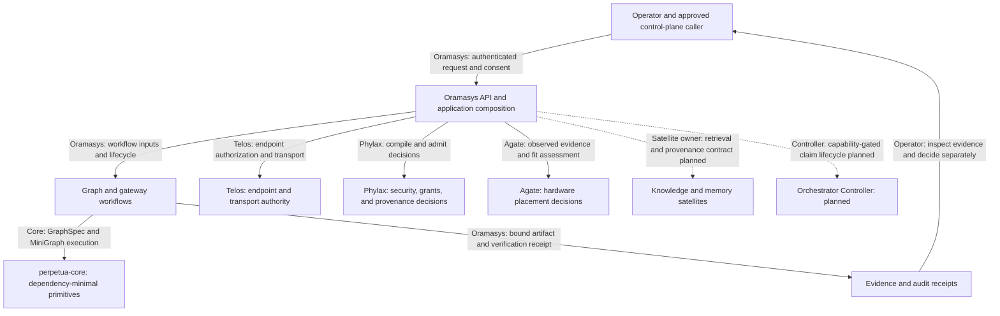
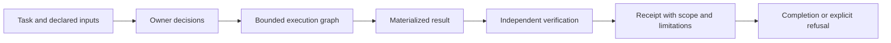

# Architecture Map — v2 Oramasys Constellation

Oramasys composes application workflows above the `perpetua-core` kernel. This
is the overarching router and map: it identifies the moving parts, their
decision boundaries, and the contracts that let us build an inspectable
constellation. Markdown is a treasure trail to those contracts, code, tests,
receipts, and sources; it never creates a second control plane or claims that
every planned satellite is wired or serving.

In the vocabulary of the legacy method's
[escalation card](https://github.com/diazMelgarejo/orama-system/blob/main/bin/orama-system/cidf/references/skill-chain-loop-graph-reference-card.md),
this map describes the **Constellation** shape: several repositories or owners
compose one system. Choosing between a skill, chain, loop, or graph before that
point is covered by the
[Orama system v1 architecture map](https://github.com/diazMelgarejo/orama-system/blob/main/ARCHITECTURE.md).

## System Shape

The arrow from Oramasys to Core is one way: application composition may import
the kernel (pinned by commit in `pyproject.toml`); the kernel must not import
Oramasys or a satellite. Dashed edges are planned, not wired. A satellite
returns a decision through its declared contract rather than donating its
policy implementation to the application.

Edge labels name the owner and the exchanged contract, not an assertion that every
deployment enables it. Contract routes: [API callers](src/orama/api/),
[application graph composition](src/orama/graph/perpetua_graph.py),
[Core execution seam](src/orama/graph/admission_runtime.py),
[Telos authority](docs/architecture/telos-network-authority.md),
[owner-adapter seams](src/orama/graph/adapters.py),
[controller design](docs/architecture/orchestrator-controller-invariants.md),
and [offline artifact/receipt contract](docs/plans/2026-10-16-local-workspace.md).
The knowledge/memory edge is a planned adapter boundary, not a claimed universal
satellite protocol; define its owner-specific schema before wiring it. Agate fit
evidence is not authorization, and an evidence receipt is not operator approval.

## Build a Constellation

Build outward from an outcome, keeping each added capability independently
inspectable and removable:

1. Declare the user outcome, audience, local-first privacy profile, inputs,
   expected artifact, and explicit limits.
2. Draw the smallest typed execution graph that owns state transitions,
   checkpoints, recovery, and a measurable stop condition.
3. Assign each decision to one owner: Core for structure; Oramasys for
   composition; Telos for endpoints; Phylax for grants/provenance; Agate for
   placement; a dedicated satellite for memory or retrieval; and an operator
   for approval.
4. Define an owner contract rather than duplicating a satellite's policy:
   capability discovery, request/response schema, privacy label, failure
   behavior, provenance, and receipt.
5. Materialize a real local artifact first, independently verify it, and keep
   the receipt's scope and limitations with the result.
6. Add one satellite or provider only after offline tests demonstrate its
   boundary. Progressive sharing is opt-in; a missing required verifier stays
   fail-closed.

This makes a constellation a graph of explicit contracts—not a monolith, a
shared mutable cache, or a collection of undocumented integrations.

## Ownership Map

| Concern | Authority | Oramasys responsibility |
| --- | --- | --- |
| Graph primitives, state reduction, and structural identity | `perpetua-core` | Compose Core contracts without an upward dependency. Legacy `policy.py`, `llm.py`, and `gossip.py` modules still exist in Core; their presence does not transfer satellite authority. |
| Workflow, API, routing, lifecycle, and user-facing state | Oramasys | Own application behavior and explicit orchestration. |
| Endpoint identity, address admission, egress, and peer verification | Telos | Gateway and discovery import Telos in process; ask for semantic authorization and do not add raw network clients. |
| Grant verification, provenance, audit redaction, and principal/capability admission | Phylax | Optional grant-serving composition lives in `scripts/`, outside `src/orama`; remain fail-closed when a required verifier is absent. |
| Hardware placement and local capability | Agate | Graph composition imports Agate in process; fit evidence is not authorization. |
| Job claims, handoffs and job-claim leases | Planned v2 Orchestrator Controller | The [controller](docs/architecture/orchestrator-controller-invariants.md) is a design-only internal module; a standalone repository remains a gated later option. PT owns v1 coordination. Existing [execution run-lease fencing](src/orama/graph/execution_guard.py) is distinct and already implemented. |
| Local documentation search | Oramasys | The [knowledge surface](src/orama/knowledge/) provides read-only search and MCP/A2A routes. |
| Configured memory and retrieval satellites | Dedicated owners | Planned boundaries require explicit contracts; label derived data and preserve provenance. |
| Design decisions, ownership registry and capability schema | Orama `docs/v2` and `docs/schemas` | These are documentation and CI inputs, not v1 runtime dependencies. |
| Human approval and deployment choice | Operator | Keep approval distinct from routing, evaluation, and completion. |

The owner adapter definitions in `src/orama/graph/adapters.py` are composition
seams, not evidence that production imports or wires them. Telos and Agate also
have direct in-process imports as described above. Phylax grant-serving code is
an optional script-side composition; this map does not claim it is activated.

## Five Graphs, Five Meanings

| Graph | Shared meaning | Core question | Required record |
| --- | --- | --- | --- |
| Execution | State transitions and bounded execution. | What runs and what transitions next? | Typed graph/state contract with checkpoints. |
| Coordination | Claims, handoffs, leases, and acknowledgements. | Who owns a claim, handoff, or lease? | Durable event identity, actor, and lifecycle state. |
| Knowledge | Source relationships and derived knowledge. | What concepts and sources relate? | Source, time, confidence, and derived-view labeling. |
| Evidence | Support for bounded claims. | Why is a claim supported? | Bound artifacts, tests, source references, or a human decision. |
| Audit | Independent review scope and unresolved limits. | Who independently checked it and what remains open? | Review scope, authority, limitation, and receipt. |

This taxonomy mirrors the one in the v1 architecture map. Its meanings are
defined there; this table adds only the v2 record shapes, so change both
documents together.

CI checks only graph names and **Shared meaning** against an immutable v1 revision;
v2 questions, record shapes and surrounding prose need not match. See the
[paired-update procedure](docs/plans/2026-10-17-architecture-router-map.md#cross-map-parity).

These graphs may reference each other but must not be collapsed into a mutable
shared cache. A queue event is not an authorization decision; an index hit is
not source evidence; and a model or evaluator result is not operator approval.

## Composition Lifecycle

For consequential work, each stage must identify the state owner, effect
owner, idempotency/recovery rule, evidence source, and stop condition. An
ambiguous external effect remains uncertain until it is reconciled by the
owning system; a retry must not manufacture certainty.

## Current and Planned Boundaries

The current application exposes graph, gateway, provider, and control-plane
surfaces. Its documented boundaries are:

- [Telos network authority](docs/architecture/telos-network-authority.md)
- [Gateway-to-Telos migration](docs/architecture/gateway-telos-endpoint-security-migration.md)
- [Orchestrator-controller invariants](docs/architecture/orchestrator-controller-invariants.md)
- [Outbound consumer authority ledger](docs/architecture/outbound-consumer-authority-ledger.md)
- [M1 compatibility review](docs/COMPATIBILITY_REVIEW_2026-10-09.md) (historical; its pins predate the current generation)

The local workspace proof of concept implements the first offline child slice:
selected passages become an extractive CSV and a separately verifiable receipt
entirely in request memory. Its contract, privacy profiles, and limits are
documented in [the local workspace plan](docs/plans/2026-10-16-local-workspace.md).
It does not qualify configured retrieval, a model adapter, durable recovery,
or provider serving. Those follow only after additional offline evidence and
must retain Telos, Phylax, and Agate authority boundaries.

## v1 and Secondary Reference Matches

The legacy method remains a parallel source of operational guidance, not a
runtime dependency:

- [Orama system v1 architecture map](https://github.com/diazMelgarejo/orama-system/blob/main/ARCHITECTURE.md)
- [MiniGraph reconciliation](https://github.com/diazMelgarejo/orama-system/blob/main/docs/v2/57-minigraph-final-reconciliation.md)
- [Policy ownership decision](https://github.com/diazMelgarejo/orama-system/blob/main/docs/v2/references/loop-graph-compatibility-2026-10-09/ADR-D-LG-1-POLICY-OWNERSHIP.md)
- [Oramasys mastery methodology](https://github.com/diazMelgarejo/orama-system/blob/main/docs/v2/references/ORAMASYS-MASTERY-v3.md) (review draft)

The PT loop/graph closure and Phase 0 LLM Wiki remain secondary reference
matches, not v2 authority:

- [PT loop/graph closure record](https://github.com/diazMelgarejo/Perpetua-Tools/blob/main/.agent/memory/working/LOOP_GRAPH_REVISION4_CLOSURE_2026-10-09.md):
  historical ownership split, evidence rules, and then-open limits; the
  [later retrospective](https://github.com/diazMelgarejo/Perpetua-Tools/blob/main/.agent/memory/working/LOOP_GRAPH_SAGA_RETROSPECTIVE_2026-10-10.md) records the merged outcome.
- [Phase 0 LLM Wiki graph](https://github.com/diazMelgarejo/Perpetua-Tools/blob/main/docs/phase-0-specifications/wiki/README.md)
  and [typed edges](https://github.com/diazMelgarejo/Perpetua-Tools/blob/main/docs/phase-0-specifications/wiki/edges.md):
  the historical July 2026 STM/mesh-security document graph.

## Readiness Boundary

This architecture map is documentation and routing guidance. It does not
enable grant serving, promote package pins, qualify M1, activate a provider,
introduce a scheduler, or authorize a merge. Those transitions require their
own contracts, tests, receipts, independent review, and any required operator
decision.
