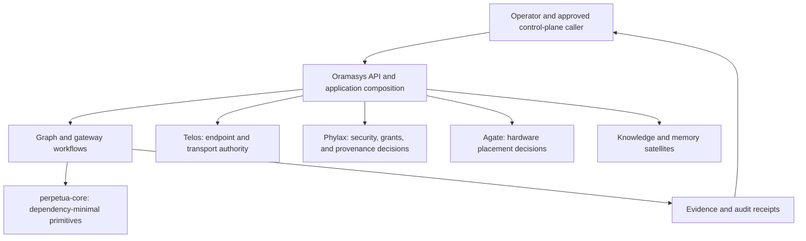
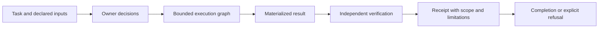

# Architecture Map

Oramasys composes application workflows above the `perpetua-core` kernel. This
map identifies the owners and records that make a constellation inspectable; it
does not claim that every planned satellite, skill, or memory integration is
already wired or serving.

## System Shape

The arrow from Oramasys to Core is one way: application composition may import
the kernel; the kernel must not import Oramasys or a satellite. A satellite
returns a decision through its declared contract rather than donating its
policy implementation to the application.

## Ownership Map

| Concern | Authority | Oramasys responsibility |
| --- | --- | --- |
| Graph primitives, state reduction, and structural identity | `perpetua-core` | Compose Core contracts without an upward dependency. |
| Workflow, API, routing, lifecycle, and user-facing state | Oramasys | Own application behavior and explicit orchestration. |
| Endpoint identity, admission, egress, and peer verification | Telos | Ask for semantic authorization; do not add raw network clients. |
| Grant verification, provenance, audit redaction, and admission | Phylax | Consume decisions; remain fail-closed when a required verifier is absent. |
| Hardware placement and local capability | Agate | Request placement; do not infer hardware policy locally. |
| Memory, retrieval, and knowledge indexes | Dedicated satellites | Label derived data and preserve source/provenance boundaries. |
| Human approval and deployment choice | Operator | Keep approval distinct from routing, evaluation, and completion. |

## Five Graphs, Five Meanings

| Graph | Core question | Required record |
| --- | --- | --- |
| Execution | What runs and what transitions next? | Typed graph/state contract with checkpoints. |
| Coordination | Who owns a claim, handoff, or lease? | Durable event identity, actor, and lifecycle state. |
| Knowledge | What concepts and sources relate? | Source, time, confidence, and derived-view labeling. |
| Evidence | Why is a claim supported? | Bound artifacts, tests, source references, or a human decision. |
| Audit | Who independently checked it and what remains open? | Review scope, authority, limitation, and receipt. |

These graphs may reference each other but must not be collapsed into a mutable
shared cache. A queue event is not an authorization decision; an index hit is
not source evidence; and a model or evaluator result is not operator approval.

## Composition Lifecycle

For consequential work, each stage must identify the state owner, effect
owner, idempotency/recovery rule, evidence source, and stop condition. An
ambiguous external effect remains uncertain until it is reconciled by the
owning system; a retry must not manufacture certainty.

## Current and Planned Boundaries

The current application exposes graph, gateway, provider, and control-plane
surfaces. Its documented boundaries are:

- [Telos network authority](docs/architecture/telos-network-authority.md)
- [Gateway-to-Telos migration](docs/architecture/gateway-telos-endpoint-security-migration.md)
- [Orchestrator-controller invariants](docs/architecture/orchestrator-controller-invariants.md)
- [Outbound consumer authority ledger](docs/architecture/outbound-consumer-authority-ledger.md)
- [M1 qualification records](docs/COMPATIBILITY_REVIEW_2026-10-09.md)

The planned source-backed CSV artifact is deliberately not represented as a
shipped feature here. Before implementation, its child design must bind source
fixtures, task identity, CSV output, independent verifier, path/spreadsheet
safety, receipt retention, and failure/recovery behavior. Configured retrieval
or model adapters follow only after that offline proof and must retain Telos,
Phylax, and Agate authority boundaries.

## v1 and Design-Corpus References

The legacy method remains a parallel source of operational guidance, not a
runtime dependency:

- [Orama system v1 architecture map](https://github.com/diazMelgarejo/orama-system/blob/main/ARCHITECTURE.md)
- [MiniGraph reconciliation](https://github.com/diazMelgarejo/orama-system/blob/main/docs/v2/57-minigraph-final-reconciliation.md)
- [Policy ownership decision](https://github.com/diazMelgarejo/orama-system/blob/main/docs/v2/references/loop-graph-compatibility-2026-10-09/ADR-D-LG-1-POLICY-OWNERSHIP.md)
- [Oramasys mastery standard](https://github.com/diazMelgarejo/orama-system/blob/main/docs/v2/references/ORAMASYS-MASTERY-v3.md)

The PT loop/graph closure and Phase 0 LLM Wiki are secondary historical and
document-graph references, not v2 authority:

- [PT loop/graph closure record](https://github.com/diazMelgarejo/Perpetua-Tools/blob/main/.agent/memory/working/LOOP_GRAPH_REVISION4_CLOSURE_2026-10-09.md)
- [Phase 0 LLM Wiki graph](https://github.com/diazMelgarejo/Perpetua-Tools/blob/main/docs/phase-0-specifications/wiki/README.md)
  and [typed edges](https://github.com/diazMelgarejo/Perpetua-Tools/blob/main/docs/phase-0-specifications/wiki/edges.md)

## Readiness Boundary

This architecture map is documentation and routing guidance. It does not
enable grant serving, promote package pins, qualify M1, activate a provider,
introduce a scheduler, or authorize a merge. Those transitions require their
own contracts, tests, receipts, independent review, and any required operator
decision.
