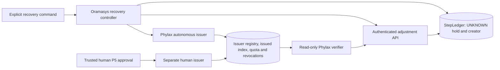

# Task 6 Operator Provisioning and Autonomous Tier Implementation Plan

> For agentic workers: use `superpowers:subagent-driven-development` for independent implementation and review, or `superpowers:executing-plans` for a single-worker execution. This document is a planning artifact; implementation starts after its written review.

**Goal:** Make adjustment-grant recovery operational through explicit operator commands, with public-key-only web serving and autonomous settlement limits that increase only after reviewed issuer isolation.

**Architecture:** Phylax owns provisioning, issuance, public verification, revocation and durable quota policy. Oramasys owns hold creation, recovery-intent creation, authenticated consumption and runtime composition. The web server has no signing secrets; separate issuance invocations use either the autonomous signing key or fresh human P5 authorization.

**Tech stack:** Existing Python packages, SQLite WAL and transactions, PyNaCl RFC 8032 Ed25519ph, existing FastAPI adjustment route, POSIX private-file primitives. No new cryptographic implementation or background recovery daemon.

**Spec:** The design contract below, reconciled against the ratified Task 6 wire contract (`PHYLAX-ADJUSTMENT-GRANT-DESIGN-v2.md`, sections 11-13; that source document is not yet published in any oramasys repository, so the pinned, checked-in artifacts that enforce it are the linkable contract: the [v1 conformance vector](https://github.com/oramasys/phylax/blob/a77b2a21a7aebadd0bd646d35e658c64104592e1/docs/vectors/adjustment-grant-v1.json), the [Phylax issuer](https://github.com/oramasys/phylax/blob/a77b2a21a7aebadd0bd646d35e658c64104592e1/src/phylax/adjustment_grant.py) and the [Oramasys verifier port](https://github.com/oramasys/oramasys/blob/5c75a75f2840a48b31c0ba53bf066e3a075f7cfe/src/orama/graph/grant_verifier.py)), Claude's provisioning section and live GossipBus records listed in the provenance table.

**Status:** C4 policy selected directly by the operator in the Codex session, 2026-10-12. Claude, AntiGravity and an independent Cline review accepted the policy and identified the tracked plan refinements in Tasks 0, 3, 5 and 7 below. No new tier, account, secret provisioning or runtime activation has been executed by this plan.

**Owner:** `codex-reviewer`, synthesizing Claude and AntiGravity contributions. This is the shared plan; earlier agent-local drafts remain historical proposals.

## 1. Source reconciliation and current state

| Source | Contribution retained or corrected |
| --- | --- |
| Claude board rows 4239/4242 | Same-user baseline, tier separation, owner binding, initial 3/6/900 limits. |
| Claude rows 4252/4253 | Operator-command trigger, quota math, provisioning commands and tests proving seed-free serving. |
| Codex rows 4246/4262 | Verify-only opening, separate issuance, three secret roles, canonical retry identity, immutable key tier, explicit isolation review gate; direct operator C4 selection. |
| Claude rows 4255-4258/4263 | C4 alternatives, arithmetic correction, read-only issued index, three ledger openers, review of inconsistencies in Agy's earlier draft. Claude accepts the stronger C4 isolation gate. |
| Agy rows 4245/4247/4260/4264 | Owner binding, registry-derived tier, read-only verification, corrected API responses and C4 consensus. |
| Independent GPT-5.6 Sol medium review | Shared-bearer limitations, atomic quota/idempotency, mixed-version activation and immutable receipt migration. Sol was available; Terra was not exposed in the subagent catalog. |

Retain the ratified Ed25519ph framing and canonical v1 body unchanged. Supersede earlier proposed 5-step/1800-second values, automatic UID-based quota upgrades, per-run counters, and claims of a 12-step concurrent limit without a separate counter.

Current code references: [Phylax #7](https://github.com/oramasys/phylax/pull/7), baseline `8ec741b`, hardening `17dbe18`, startup update `1793fba`; [Oramasys #33](https://github.com/oramasys/oramasys/pull/33), reviewed head `737614f`. Merged Task 6 mechanics were verified at Phylax `3d9c155` and Oramasys `5c75a75`. Execution must refresh PR heads and dependency versions, record the actual source SHA, and create isolated worktrees from those verified refs.

The current composition script calls `open_grant_authority`, which loads issuer and P5 secrets. It is not the final verify-only deployment. Existing core tests and the 8/8 interop probe establish the grant/ledger seam, not the future provisioning path.

## 2. Design contract and approved C4 policy

| Property | Level 0: same-user baseline | Level 1: reviewed isolated issuer |
| --- | --- | --- |
| Autonomous action | `settle` only | `settle` only |
| Units basis | `steps` only | `steps` only |
| Maximum units per grant | 3; smaller positive adjustments are allowed | 3 |
| Lifetime | Exactly 900 seconds | Exactly 900 seconds |
| Rate | 6 autonomous grants per rolling 3600 seconds | 12 per rolling 3600 seconds |
| Scope | Authenticated principal across all runs, stores/keys using the same authoritative issuer quota domain | Same |
| Accounting bound | At most 18 settlement steps in any rolling hour | At most 36 |
| Activation | Explicit policy registration | Separate deployment evidence review and explicit operator activation |

All grants could be issued within one 900-second interval, so the maximum outstanding grant units are 18 or 36 respectively. There is no separate 12-step concurrent gate in this plan. These figures bound recovery settlement attestations, not new LLM dispatch capacity or a dollar budget.

The rolling window counts successful autonomous issuances with `issued_at > now - 3600` and `issued_at <= now`. A grant exactly 3600 seconds old no longer occupies a slot. Grant expiry, revocation and consumption do not refund a slot. Exact issuance retries return the original wire without another slot; rejected issuance creates no accepted quota entry. Human-gated grants do not count merely because their kind is also `settle`.

The existing shared bearer authenticates the single `local-operator` capability. All agents using it share one quota bucket; recorded creator ownership proves that capability identity, not individual agent identity or fairness. Distinct per-agent security would require a separately reviewed credential contract.

### C4 isolation gate

Different file-owner UIDs alone cannot activate Level 1. The reviewed deployment must establish signer/server account separation, restrictive mode and effective ACL/group access, the configured least-privilege threat model, authenticated run-scoped invocation, server inability to read secrets, and retirement of legacy issuer write access. Record operator approval and deployment evidence in a versioned activation record. Caller flags, key names, configuration strings and `stat` output cannot double the cap.

At Level 0, same-user processes may use the authority database through the read-only verifier opening described below. At Level 1, a server under another UID must not gain filesystem read access merely to open that issuer-owned database. The isolation design therefore needs one separately reviewed, authenticated local verifier transport or a signed, minimal public-state publication with an explicit freshness/revocation proof. It must expose verification/revocation facts only, never issuer-store writes or seed access. This transport is an activation prerequisite, not a shortcut around the isolation gate.

Key-to-tier mapping is immutable. Deployment policy is independently versioned; new grants retain their issuance policy revision in durable authority records. Replays retain their original grant and policy evidence across activation changes. Quotas aggregate across key rotations and policy revisions so changing a key or policy cannot reset the bucket. Downgrading limits does not erase earlier accepted entries.

Same-user operation retains the known limitation: another process with the same OS identity can read seeds, edit state and invoke CLI commands. Explicit operator invocation is an operational trigger, not cryptographic proof that the caller is human. Human-tier issuance still requires fresh evidence from the trusted P5 interaction boundary.

## 3. Components, interfaces and data flow

The server, run controller and recovery command may open the same durable StepLedger. SQLite transactions serialize their mutations; every consumer independently rechecks owner, UNKNOWN eligibility, epochs, basis and remaining balance inside the transaction.

**Proposed Phylax interfaces:** `GrantVerifierConfig(authority_db, verifier_id)` and `open_grant_verifier(config, clock=None)` expose only `verify(wire)` and `revocation(grant_id)`. Verification needs trusted public keys, the exact issued-grant index and revocations. It opens SQLite with URI `mode=ro`, never creates/migrates state, never uses `immutable=1` for live revocations, and initializes no seed provider or P5 authority.

`AutonomousGrantIssuer.issue(request, *, authenticated_principal, recovery_intent_id)` uses only its autonomous signer and registered policy. The autonomous request contains target, evidence and requested positive step units; it has no configurable kind, duration, tier or human-evidence parameter. The issuer constructs `settle`, `steps` and 900-second expiry itself and checks units against policy. This is a new path, not a reuse of the configurable human approval method.

**Proposed Oramasys interface:** `recover(run_id, hold_id)` is an explicit command. The controller derives a target from a durable UNKNOWN hold, records the authenticated creating principal and generates a durable recovery-intent record before calling the issuer. Only the controller reads ledger balances; Phylax does not import or inspect StepLedger.

Recovery identity uses a versioned canonical object, including principal, store/run/hold identifiers, both fencing epochs, requested units/basis/action and evidence digest. Hash canonical bytes with unambiguous framing; never concatenate raw strings. Persist one command/intent identifier and a payload fingerprint. An identical retry returns the existing grant, while reuse of that identifier with changed target data refuses. Policy revisions and key rotations do not turn a retry into a new issuance. An expired, never-consumed intent requires an explicit new operator recovery attempt; no silent renewal loop.

Phylax verifies tier through trusted immutable metadata for the signed `issuer_key_id`; prefixes such as `auto-` are labels only. The fixed v1 signed object gains no new fields. Verified tier/policy facts come from the authoritative issued record and registry, and the adapter rebuilds them into Oramasys-owned types.

## 4. State and migration rules

- Add explicit schema versions and transactional migrations before opening an issuer. Old binaries must refuse a newer authority schema; do not allow mixed-version issuers to bypass caps.
- Register an immutable tier for each key, enforce the no-update rule in storage, and support independent active-key lifecycle per tier. Retired-key retention and signed-key selection retain the ratified rules.
- Preserve three distinct secret roles: autonomous Ed25519 seed, human Ed25519 seed, and existing P5 approval/HMAC secret. Verify-only serving loads none; autonomous issuance loads only its own seed; the human issuer owns human signing and P5 evidence.
- Record issuance intent, principal, immutable tier, policy revision, grant identity/wire and quota timestamp atomically. Use one `BEGIN IMMEDIATE` for retry lookup, quota admission and durable accepted issuance; no remote call inside it. Reject clock regression rather than resetting counters.
- Add immutable creating-principal ownership to new holds through every real reservation caller. An arbitrary request-body principal is not authentication. Legacy NULL creators refuse autonomous recovery and remain eligible only for the existing authenticated human-tier P5-gated settlement compatibility path; that path does not invent an owner. Any later owner assignment is a separate human-authorized, auditable repair action with an immutable before/after record and must never be an automatic backfill.
- Keep original stored receipt bytes unchanged. New receipts may carry trusted tier metadata; legacy metadata belongs in a sidecar/projection without rewriting historical JSON. Validate stored receipt digest and duplicated identity fields before returning a retry; corruption fails closed.
- Do not introduce a new `recovery_pending` hold state. Use existing UNKNOWN state and a separate durable recovery-intent table. Consumption still rechecks current state so a concurrent settlement cannot spend twice.

## 5. Execution tasks and independent gates

### Task 0: Close current PR startup review

**Status as of 2026-10-13 04:42Z (checked against GitHub, not the board):**

- Done: Phylax #7 merged as `a77b2a2` (its final head was `f590307`).
- Partly done: Phylax #9 (`5583d6e`, stacked on #7) was closed unmerged when #7 merged. The same patch was then merged to `main` through [Phylax #10](https://github.com/oramasys/phylax/pull/10) as `18a9d2e`, which fixes the regular-file state-root contract (raw `FileExistsError` instead of `CompositionError`). Its first-key adoption was still racy, so that half is not complete on `main`.
- In review: the follow-up is [Phylax #11](https://github.com/oramasys/phylax/pull/11) (head `fc9172b`, merged with `main` after #10 landed). Review of `5583d6e` (rows 4305, 4312, 4317) found the concurrent first-key path still racy: the keyring constructor read `active_key()` and `keys()` outside the write transaction, so a worker that read an empty registry could then see a rival's committed key and refuse it. `a76ad39` decides empty/adopt/reject inside one `BEGIN IMMEDIATE` transaction (`ensure_active_key`), and `fc9172b` retries the WAL journal-mode switch when two first-time openers race (found by the empty-directory concurrency test on Python 3.11 CI). The concurrent-startup repair is **pending until #11 is reviewed and merged**; those earlier countersigns do not cover the #11 head, so they must be re-recorded against its final head SHA.
- Pending: Oramasys #33 stays last in the merge order; it imports APIs from Phylax #7, which are now on `main`.

**Files:** Phylax `src/phylax/grant_composition.py`, `src/phylax/grant_store.py`, `src/phylax/adjustment_grant.py` only if constructor changes are required, and corresponding tests.

- [x] Reproduce the `1793fba` regular-file error-contract regression and simultaneous identical first-key registration failure (reproduced again on `main` at `a77b2a2`).
- [ ] Make state-dir creation tolerate only the expected creation race, then always execute private type/owner/mode validation. Done on `main` via Phylax #10 (`18a9d2e`).
- [ ] Make first-key initialization race-free: the empty-registry decision and the insert share one registry transaction, so a losing worker adopts the committed key; a mismatched, rotated, revoked-only or historical registry must still refuse rather than overwrite state. Candidate: Phylax #11 (`fc9172b`), with tests for the read-empty/rival-commit/read-nonempty ordering and concurrent empty-directory bootstrap; not on `main`.
- [ ] Run composition and concurrent-bootstrap regressions, the full Phylax suite and `git diff --check`; both Codex and AntiGravity must re-countersign the final head of the PR that carries the repair (the new PR replacing #9), recording that exact SHA on GossipBus. Earlier approvals of `17dbe18`, `1793fba`, `43ea187` and `5583d6e` do not satisfy this gate.
- [ ] Merge through the designated publisher only after the operator's merge decision: the Phylax repair PR before Oramasys #33. (#7 is already merged; the latter imports the APIs it introduced.)

### Task 1: Public verification and tier-aware authority state

**Files:** Phylax `src/phylax/grant_store.py`, `src/phylax/adjustment_grant.py`, `src/phylax/grant_composition.py`; add `src/tests/test_verify_only_composition.py` and `src/tests/test_grant_tier_migration.py`.

- [ ] Write failing tests: verifier starts with no seed configuration/files, attempted SQLite write fails, verifier has no issue method/seed-provider reference, issuer revocation and key rotation become visible through a separate connection.
- [ ] Add the read-only verifier factory and transactional tier/version migrations. Explicitly register existing known human keys; unknown legacy authority metadata cannot silently become autonomous.
- [ ] Test immutable role updates, exact signed-key selection, malformed role/policy refusal, legacy binary rejection and byte-identical v1 conformance vectors.
- [ ] Verify matched package interfaces and commit this independently reviewable boundary after review.

### Task 2: Atomic autonomous issuance and quotas

**Files:** add Phylax `src/phylax/autonomous_grant.py`; modify `src/phylax/grant_store.py`; add `src/tests/test_autonomous_grant.py`.

- [ ] Write failing tests for units 1-3 accepted/4 refused, release/non-step input refused, exact 900-second lifetime and no human-evidence override.
- [ ] Define the intent/issuance schema and `AutonomousGrantIssuer` facade described above. Perform durable retry and principal-wide quota admission atomically with successful issuance.
- [ ] At Level 0 test the first six grants accepted and seventh refused; at reviewed Level 1 test twelve accepted and thirteenth refused. Test concurrent issuers, cross-run/key/policy aggregation, restart, rolling boundary, expired/revoked grants retaining their slots and failed issuance leaving no accepted slot.
- [ ] Test exact retries before/after restart or activation change, changed-payload conflicts, clock regression and crash points around durable commit. A durable accepted issuance may be retrieved after a lost response without minting a replacement.
- [ ] Record trusted tier/principal/policy evidence for verification and audit. Human settlement grants do not occupy the autonomous bucket.

### Task 3: Creator binding and authenticated consumer receipts

**Files:** Oramasys `src/orama/graph/execution_guard.py`, `src/orama/graph/grant_verifier.py`, actual authenticated reservation callers, `src/orama/api/contracts.py`; add `src/tests/test_adjustment_owner_binding.py` and extend receipt/replay tests.

- [ ] Trace persistence -> reservation caller -> verifier port -> consumer -> HTTP response, preserving authenticated principal provenance.
- [ ] Test mismatched or missing creator, stale epochs, non-UNKNOWN holds and a creator field supplied by untrusted request data. Persist owner at creation and refuse changes.
- [ ] Add the migration, verified tier projection and legacy-safe receipt handling; refuse autonomous NULL-owner holds without inventing historical ownership. Preserve the existing authenticated human-tier P5-gated settlement path for those legacy holds, and test that it cannot mint or spend an autonomous grant.
- [ ] If durable owner repair is needed, add it as a separately authorized human-tier operation with actor, evidence reference, old/new values and timestamp; it must refuse ambiguous candidates and never run as a bulk backfill.
- [ ] Test immutable retry after expiry/revocation, digest corruption, mismatched duplicated fields, partial-unit accounting, restart and the three-process ledger access pattern.

### Task 4: Explicit recovery and separate issuer invocation

**Files:** add Oramasys `src/orama/graph/recovery.py` and `scripts/recover_unknown_hold.py`; add Phylax `src/phylax/grant_cli.py`; add command/interop tests in each repo.

- [ ] Test that a passive UNKNOWN observation never mints a grant. An explicit command derives owner-bound intent from current ledger facts rather than accepting arbitrary target ownership.
- [ ] Implement Phylax commands `provision`, `issue-human`, `issue-autonomous`, `revoke`, `rotate` and `ready` with separate secret dependencies. Obtain human evidence through the trusted P5 boundary, not a caller's claim to be human.
- [ ] Start Level 0 with short-lived issuer CLI invocation; a resident privileged broker is a Level 1 deployment change requiring authenticated scoped IPC and independent review.
- [ ] Test durable intent retry, cross-run/store/principal conflict, explicit new attempt after expiry, issuer unavailable, quota refusal and a competing consumer settling the hold before this command spends.

### Task 5: Provisioning runbook and secret-free server composition

**Files:** Phylax provisioning CLI/tests and `docs/operator-grant-provisioning.md`; Oramasys `scripts/serve_with_phylax_grants.py`, API tests and `docs/adjustment-recovery.md`.

- [ ] Provision high-entropy distinct secrets with atomic exclusive creation, mode 0600 files in mode 0700 directories, descriptor validation and no overwrite. Print identifiers/status only; never key bytes or concrete workstation paths.
- [ ] Refactor the HTTP composition to `open_grant_verifier`, remove signing-seed/P5 configuration requirements, and document the shared ledger file used by server/controller/command.
- [ ] Prove startup and verification with seed root absent, unset and inaccessible; audit file opens to prove no seed-root access. Test the read-only database with a write that must fail.
- [ ] Run a real file-backed issuance -> authenticated HTTP consumption -> exact retry -> revoke -> read-only stored receipt flow. Stub-verifier API tests and the older ledger probe are supplementary evidence, not substitutes.
- [ ] Document startup, backup, restart, rotation, revocation and rollback. The verified cross-process revocation freshness bound is `REVOCATION_MAX_AGE_SECONDS = 60`; an older observation refuses verification. Rollback disables recovery/consumption while preserving ledger/authority state and issuer quotas; no reset-to-empty recovery.
- [ ] Report verifier-ready, issuer-ready and autonomous-policy-ready separately. The verify-only server reports issuer state only via an authenticated diagnostic result; readiness must not load secrets or claim issuance capability from a public registry alone.
- [ ] Supersede the current Phylax README statement that the autonomous tier is deferred when, and only when, Task 2 has shipped with its tests and this Task 5 operational evidence.

### Task 6: Reviewed C4 Level 1 activation

**Files:** versioned Phylax deployment-policy state and tests; operator deployment runbook. Account and IPC configuration is local deployment material.

- [ ] Establish the isolated signer account and authenticated invocation boundary without giving agent/server principals signing-user, secret-file or issuer-store write privileges under the selected threat model.
- [ ] Provide the reviewed Level 1 verifier transport or signed public-state publication; test effective access denial from the actual serving identity, broker caller scope, secret-free serving, revocation freshness and mixed-version issuer refusal. Ownership/mode inspection is supporting evidence, not the activation decision.
- [ ] Record operator-approved evidence and a new activation revision, then select the twelve/hour policy. Test existing quota entries remaining counted across activation and downgrade.
- [ ] Document human-gated recovery for demand above the autonomous quota; do not silently raise the autonomous cap or renew grants.

### Task 7: Durable decision record

**Files:** add an Oramasys `docs/v2/` ADR and the generated/permitted Perpetua-Tools pointer, following the two-repository documentation authority rules.

- [ ] Record the operator-command trigger, principal-wide issuance-time quota, C4 Level 0/Level 1 limits, immutable registry-tier versus versioned deployment-policy distinction, and the explicit non-goals: no automatic minting, no automatic legacy-owner backfill and no activation by UID inspection alone.
- [ ] Link the ADR to this local planning artifact, Phylax #7, Oramasys #33 and the final deployment-evidence record without copying secrets, local paths or operator credentials into tracked documentation.
- [ ] Require the ADR before Task 6 activation, not before the bounded PR #7 startup repair.

## 6. Review focus and completion

| Failure mode | Required proof |
| --- | --- |
| Same-user file replacement or unsafe state | Existing descriptor/symlink tests plus Task 0 concurrent bootstrap and error-contract tests. |
| Grant storm through retries, new runs or rotation | Task 2 atomic principal-wide counts and immutable intent replay. |
| Unknown owner or forged tier | Task 1 immutable registry role and Task 3 authenticated durable creator tests. |
| Signing secrets reach web runtime | Task 5 absent/unreadable-root startup, descriptor audit and read-only DB write refusal. |
| Stale revocation view permits a revoked grant | Task 5 verifies a `REVOCATION_MAX_AGE_SECONDS = 60` freshness refusal and documents that cross-process bound. |
| Higher quota activated by misleading isolation evidence | Task 6 effective identity/access tests and explicit versioned operator activation. |

Before execution, reviewers must check the exact proposed interfaces, legacy migration and Tier-0/Tier-1 deployment boundaries. Each implementation batch gets focused red/green tests, matching producer/consumer contract tests, appropriate full-suite checks and a final diff check. Record source SHAs and results on GossipBus with workspace paths. Existing unrelated dirty worktrees and historical memory are preserved.

The final feature is complete only when both independent reviews agree, matched dependencies are available, the real authenticated end-to-end recovery passes, operators have provisioning/rotation/revocation/rollback instructions, and readiness distinguishes code availability from deployment activation. Merging a library does not satisfy this gate.

Publication and merge remain designated-reviewer/operator actions. This plan is published for review on Oramasys PR #34; C4 selection approves the policy design, not creation of service accounts, production provisioning, or automatic deployment.

## 7. Cross-references and review record

- [Phylax startup-race repair PR #9](https://github.com/oramasys/phylax/pull/9) (closed unmerged on 2026-10-13); its patch landed through [PR #10](https://github.com/oramasys/phylax/pull/10) (merged as `18a9d2e`), with the remaining race fix on [PR #11](https://github.com/oramasys/phylax/pull/11) (open; see Task 0 status).
- [Oramasys ADR 56: C4 policy decision](56-operator-provisioning-and-autonomous-tier-adr.md).
- [Phylax merged issuer PR #6](https://github.com/oramasys/phylax/pull/6).
- [Oramasys merged consumer PR #32](https://github.com/oramasys/oramasys/pull/32).
- [Phylax provisioning PR #7](https://github.com/oramasys/phylax/pull/7) (merged as `a77b2a2`).
- [Oramasys adjustment API PR #33](https://github.com/oramasys/oramasys/pull/33).
- Live board: `TASK6_C4_DIRECT_OPERATOR_SELECTION_AND_CODEX_REPLY_20261012`, `TASK6_PARALLEL_SUBAGENT_FINDINGS_AND_C4_PLAN_PROGRESS_20261012`, `REVIEW_OF_CODEX_CANONICAL_PLAN_20261012`, and the publication/review-request topic for this plan.

Claude, Agy and the independent reviewer have reviewed the original shared file. This revision incorporates their F-A through F-E findings; they should confirm the revised sections before implementation begins. Approval of earlier agent-local proposals does not replace review of this reconciled text.

## 8. 2026-10-13 validation addendum

The two Task 0 startup races were addressed in Phylax commit
`43ea187b4501bb9eceb2bab9406bb8e911e832c5`, descended from the previously
reviewed `1793fba` candidate. Neither repair is on Phylax `main` yet, and the
second was later found incomplete (see Section 8.1):

1. An existing file, symlink, or unsafe directory at the state-root path now
   reaches the established private-path validator rather than leaking a raw
   creation error.
2. Concurrent identical pristine first-key initialization was intended to adopt
   exactly one active durable record inside the registry transaction. As first
   written this was only partly true: the keyring constructor's own reads
   happened outside that transaction. The complete repair is pending (Section
   8.1). Mismatched, rotated, revoked, historical, or multi-record state must
   continue to refuse.

Independent validation of the original repair in a clean detached worktree ran
the complete Phylax suite with declared test and crypto dependencies: **129
passed**, **88.76% coverage**, and `git diff --check 1793fba..43ea187` was clean.
Those initial countersigns applied to `43ea187`, not to the subsequently
discovered live PR source or its rebased candidate.

This addendum, as first written, did **not** assert that Phylax PR #7 or #9, or Oramasys PR #33,
had merged; see the Task 0 status for the current state. GitHub API authentication was unavailable during the initial
validation. For the current pushed candidate and review state, see Section 8.1.

The durable C4 decision record is Oramasys ADR 56. It records the Level 0
six-grants-per-hour policy, Level 1 isolation gate, durable quota and recovery
rules, and the explicit non-activation boundary. It is published alongside
this plan in the Task 6 documentation change.

### 8.1 Rebase reconciliation

Git transport verified that the live Phylax source branch had advanced to
`f590307` but did not contain `43ea187`. The startup-race repair was replayed
without manual reconstruction as local candidate `5583d6e` on that source. Its
stable patch identity is identical to the original repair
(`027ddb79715bc980798cbbd610778f44519beb1b`), and the candidate changes only
`grant_composition.py`, `grant_store.py`, `test_adjustment_grant.py`, and
`test_grant_composition.py`.

Candidate validation and review now apply to `5583d6e`, published as Phylax
PR #9 stacked on the still-open PR #7:

- Codex review: **132 passed**, **88.75% coverage**, clean diff check; approval
  recorded on GossipBus row 4305.
- AntiGravity review: **135 passed**, **89.47% coverage**, exact patch identity
  and four-file scope confirmed; approval recorded on row 4312.
- Claude completed independent verification in the existing worktree; their
  `APPROVE` is recorded on row 4317. They reproduced the patch identity, scope,
  full-suite result, and bootstrap invariants.

Exception contract clarification from Claude's review: invalid state-path
collisions are reported through `CompositionError` by the composition
validators. Refusal to re-register an already initialized, changed, revoked,
or historical registry key is a plain `ValueError` from
`register_initial_key`. The latter is the existing tested API contract; no
code change is indicated. Earlier summaries that grouped both cases under
`CompositionError` were imprecise.

At the time of that review the candidate was pushed and PR #9 was open. Update,
2026-10-13 04:42Z: PR #7 merged as `a77b2a2` and PR #9 was closed unmerged, so
`5583d6e` is not on Phylax `main` (see Task 0 status). The operator authorized
resuming Task 6 and opening the PR. Merge remains a separate operator decision.

Review of `5583d6e` (Greptile on #9) showed that `RotatingIssuerKeyring.__init__`
read `active_key()` then `keys()` before calling `register_initial_key`, so
worker B could read an empty registry, worker A could commit, and B would then
see a nonempty `keys()` and raise "no active key". The repair was re-targeted
onto `main` as Phylax PR #11, head `a76ad39`
(`5583d6e` cherry-picked unchanged, plus one commit): a single
`ensure_active_key` store method makes the empty/adopt/reject decision under
`BEGIN IMMEDIATE`, and the constructor no longer reads the registry outside it.
Tests cover that ordering, a barrier at the transaction with two concurrent
workers, and revoked-only rejection; the Phylax suite passes (213 tests).
This plan treats the startup-race repair as **pending** until #11 is reviewed,
countersigned at its final head SHA and merged. The exception contract above is
unchanged: mismatched or non-active registries raise a plain `ValueError`.
